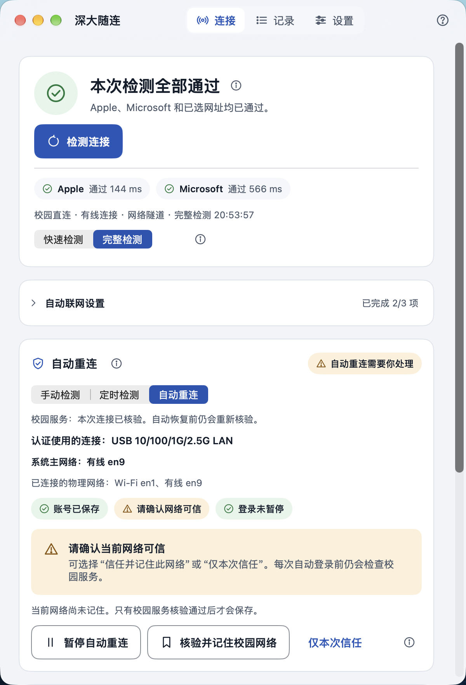
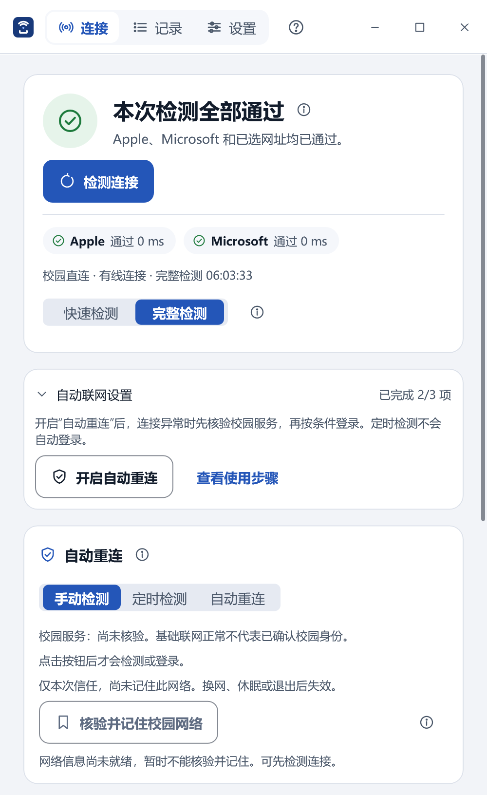

# 深大随连 · SZUConnect

深圳大学校园网连接助手，适用于粤海、丽湖校区的教学／办公区和宿舍区，支持 macOS 与 Windows。

- **检测与重连**：定时检查联网状态；开启自动重连后，掉线时使用已保存的校园账号登录。
- **后台运行**：可设为登录时启动；关窗后留在 macOS 菜单栏或 Windows 托盘。
- **自动找网**：断连时找回已记住并选定的校园 Wi-Fi，也可按需允许应用打开 Wi-Fi 开关。
- **网址检测**：添加常用网址，查看检测结果与连接记录。
- **网络排查**：对照查看当前联网、校园直连和校园登录服务状态，排查代理、VPN 或 TUN 环境下的连接问题。

## 下载

| 平台 | 安装包 | 系统要求 |
| --- | --- | --- |
| macOS | [下载 DMG（1.0.0）](https://github.com/zhihebai/SZUConnect/releases/download/v1.0.0/SZUConnect-1.0.0-macOS-universal.dmg) | macOS 14+，Apple 芯片或 Intel |
| Windows | [下载 EXE（1.1.0）](https://github.com/zhihebai/SZUConnect/releases/download/v1.1.0/SZUConnect-1.1.0-win-x64.exe) | Windows 11 x64 |

[项目说明与使用教程（PDF）](https://github.com/zhihebai/SZUConnect/raw/refs/heads/main/docs/%E2%80%9C%E6%B7%B1%E5%A4%A7%E9%9A%8F%E8%BF%9E%E2%80%9D%E9%A1%B9%E7%9B%AE%E8%AF%B4%E6%98%8E%E4%B8%8E%E4%BD%BF%E7%94%A8%E6%95%99%E7%A8%8B-v1.0.pdf)

macOS 版已签名并通过 Apple 公证。Windows 版尚未签名，首次打开时可能出现系统提示。

Windows 下载 EXE 后运行，就能安装或升级；macOS 把应用拖进“应用程序”即可。升级会保留账号、设置和网络记忆。[安装、升级与卸载](docs/INSTALLATION.md)

## 开始使用

1. 先在系统里连上校园 Wi-Fi 或网线。
2. 跟着引导保存校园账号，点“检测连接”，需要认证时再登录。
3. 点“核验并记住校园网络”，再开启“自动重连”。Wi-Fi 和网线要分别记住。

需要自动找网时，在设置里选中已记住的校园 Wi-Fi，再开启“断连时，自动找回记住的校园 Wi-Fi”；也可单独允许应用打开 Wi-Fi 开关。已有 Wi-Fi、手机热点或网线连接时，应用不会切换网络。

[使用教程](docs/USER-GUIDE.md) · [平台差异](docs/PLATFORM-DIFFERENCES.md)

开着代理或 TUN 时校园网连不上？查看[校园直连设置](docs/PROXY-DIRECT.md)，按所用软件操作。

## 界面

| macOS | Windows |
| --- | --- |
|  |  |

## 隐私与许可

账号和密码保存在系统钥匙串或 Windows 凭据管理器中，设置和记录保存在本机。应用没有广告，不收集使用统计，不直接修改系统 VPN、代理、DNS 或路由。校园直连设置只处理本人选定并确认的配置文件。[隐私说明](docs/PRIVACY.md)

项目由 zhihebai 维护，采用 MIT 许可，[第三方来源与许可](THIRD-PARTY-NOTICES.md)随项目提供，也可在“设置 → 关于 → 开源许可”中离线阅读、复制。本项目是非官方工具，与深圳大学及运营商没有隶属关系。

问题与建议可提交 [Issue](https://github.com/zhihebai/SZUConnect/issues)，其他交流也欢迎[来信](mailto:hizhihebai@163.com)。标题可写“【深大随连】邮件主题”；反馈故障时，可附操作步骤，以及“记录”中的排查摘要或报告。

如果它帮到了你，欢迎点个 Star。

[开发文档](docs/README.md)
