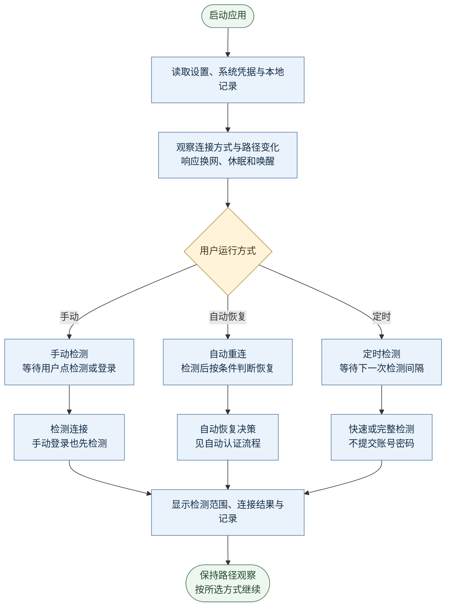
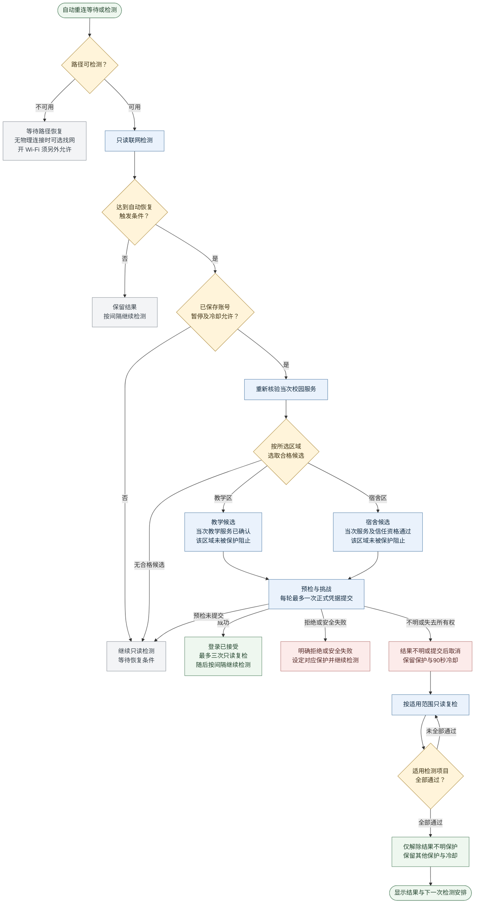

# 连接与恢复流程

本文供开发时核对检测与自动重连流程，适用于 macOS 和 Windows。日常操作见[使用教程](USER-GUIDE.md)。

“检测”不发送账号密码，“登录”在校园服务及恢复条件通过后才提交。外网连通性、校园服务核验和本次信任分别判断。

## 运行总览

[流程图](images/connection-flow.svg) · [图源文件](images/connection-flow.drawio)

- **手动检测**：等待用户操作。手动登录先重新检测，仍需恢复时才继续；已恢复或只剩网站业务错误时不提交。强制重新登录需另行确认。
- **定时检测**：周期性检测并记录结果，不自动提交凭据。
- **自动重连**：周期性检测，持续异常时检查校园服务、网络资格、暂停与冷却状态。开启此模式不等于信任当前网络。
- **开机启动**：登录项只负责启动应用。启动后仍读取用户选定的运行方式、信任和保护状态。

快速检测任一基础站点返回 HTTP 200 及预期正文即通过，停止等待另一项并跳过自选网址。完整检测包含 Apple、Microsoft 及当次启用的网址，全部通过才得到 `allPassed`。

自选网址只检查 HTTP 响应，不加载完整页面或执行 JavaScript，也不提供校园身份或认证资格。

基础检测和校园登录绕过系统 HTTP/HTTPS 代理；自选网址采用当次保存的“使用系统设置”或“绕过系统代理”选项。两种方式仍受 DNS、分流及 VPN/TUN 路由影响，浏览器的扩展、独立代理、登录状态、缓存及页面接口也可能不同。

代理、网址及校园认证的结果分别判断，按对应结果排查。

## 自动认证决策

[流程图](images/recovery-flow.svg) · [图源文件](images/recovery-flow.drawio)

图中“适用检测项目”：已绑定物理通道只核验 Apple、Microsoft；未绑定的兼容路径核验完整检测范围。常用网址不参与绑定通道的结果不明解除判断。

### 触发与选区

自动认证需要已保存账号、可用路径，且当前网络、账号和操作仍有效。基础联网连续两轮失败才进入恢复判断。

两端完整检测中的基础部分失败或固定校园门户跳转，可进入两轮确认及一轮受控恢复。同一阶段的持续部分失败不会循环提交。

两项基础均通过时，自选网址按结果类型处理：

- 普通超时、DNS 或连接失败只更新诊断及手动恢复提示，不触发自动校园认证。
- 严格校园门户跳转仍需当次校园服务核验。
- 401、403、证书问题、取消或缺失结果不能单独触发恢复。

一个部分连接故障阶段只尝试一轮恢复。用过后，须连续两轮完整检测满足两项基础通过、所有所选项目有 HTTP 回复且无校园跳转，才重新开放次数。403 算有回复，总体仍为 `partial`；仅基础通过不足以重开次数。这与结果不明保护分别处理。

每次普通手动恢复都重新检测，先前的强制登录确认不沿用。新结果正常或只剩业务错误时不提交；需要强制重新登录时，重新确认，默认取消。

每轮自动认证都重新核验适用校园服务，再按用户选择及区域保护决定候选：

| 候选 | 自动认证资格 |
| --- | --- |
| 教学区 | 当次教学服务已确认，且教学区域未被保护阻止。教学网络记忆不替代本轮核验。 |
| 宿舍区，使用本次信任 | 当次教学与宿舍服务均已确认，用户已信任当前会话，且宿舍区域未被保护阻止。 |
| 宿舍区，网络记忆强匹配 | 记录保存时具有教学及宿舍双服务证明；当前路径不含隧道且无多出口歧义，当次宿舍服务已确认。 |
| 宿舍区，网络记忆中等匹配或路径有歧义 | 记录保存时具有双服务证明，且当次教学与宿舍服务均已确认。 |

教学认证使用 HTTPS。宿舍认证使用校园 HTTP 服务，因此自动认证还需通过当前会话信任或合格的宿舍记忆。

自动选区只使用已核验且未被保护阻止的候选，各区域的拒绝保护分别保留。

用户已指定教学入口，或本轮物理线索、匹配的 SRun 配置、历史教学偏好已确定教学候选时，教学预检失败或挑战不可用均不会改试宿舍。只有自动选择仍允许回退、尚未提交凭据且宿舍资格通过时，才可重新核验并改选宿舍候选。每轮正式提交最多一次。

### 提交与保护

正式提交前先保存待确认状态并启动 90 秒冷却，保存失败则停止提交。

提交后换网、休眠、修改配置或取消会使旧操作失效。其后返回的结果不更新新状态，可能已到达服务端的请求保留结果不明保护及冷却。

登录已接受后最多进行三次只读复检，不再次提交凭据。两端已绑定通道优先核验基础联网，两项通过即结束复检，常用网址另行补查。

明确拒绝按账号版本、区域及网络范围记录保护；安全失败保持安全保护。

结果不明时保留检测偏好。已绑定通道优先完整核验 Apple、Microsoft，两项均通过即可解除结果不明保护；常用网址不参与此判断，也不标为通过。未绑定的兼容路径仍核验完整范围。

此过程保留用户暂停、密码拒绝、安全保护及未结束的冷却。明确选择“继续自动重连”可解除保护，但不能跳过已提交请求的冷却；记住网络也不解除手动暂停。

认证明确成功且绑定通道的两项基础复核通过后，另一条重新核验的物理接口可独立恢复。每个接口在内存保留原截止时间，切回旧接口仍受保护。

TUN、默认路由或 IP 变化不建立新资格。失败、取消、结果不明及重启恢复均保持全局冷却；冷却不限制只读检测，也不影响已恢复的联网。

## 网络记忆与 Wi-Fi 找网

会话信任只保存在内存中，换网、休眠或退出后清除。网络记忆保存可撤销的恢复资格，恢复时仍核验校园服务及认证保护，不自动授予会话信任。

教学区记忆只保存教学证明，不能用于宿舍自动认证。

网络特征派生后保存在本机。显示名称和真实 SSID 保存在独立的本地名称文件，仅用于显示及找网候选，不参与身份判定，不进入日志和诊断。忘记记录立即撤销本次运行中的资格，即使撤销写盘失败也不会继续使用该记录。

“自动找网”与“允许开启 Wi-Fi”分开设置，新用户默认均关闭。找网需处于自动重连模式、已保存账号、未受保护阻止、无其他进行中的操作，并且没有物理连接。

候选只来自应用内已记住、有真实 SSID 且未被排除的校园 Wi-Fi，不导入系统保存的所有网络。

Wi-Fi 关闭时，须另行允许开启电源，再取得名称读取权限及可用候选后才扫描连接。macOS 仅自动连接开放 Wi-Fi；Windows 还可使用所选网络已保存的系统连接。应用不读取无线密码。

已有 Wi-Fi、热点或网线连接时停止找网，物理状态不明时同样停止。连接后仍须匹配网络特征并核验当次校园服务，不能凭 SSID 授予恢复资格。

## 源码职责

以下路径相对仓库根目录。修改行为时，一并更新流程图、说明及回归测试。

| 职责 | 源文件 |
| --- | --- |
| 配置、调度、检测、认证及界面状态 | [AppModel.swift](../macos/SZUConnect/Sources/AppModel.swift) |
| 操作所有权、检测历史、调度退避、90 秒冷却 | [ConnectionPolicy.swift](../macos/SZUConnect/Sources/ConnectionPolicy.swift) |
| 区域候选、暂停范围、拒绝分类、结果不明保护 | [RecoveryHolds.swift](../macos/SZUConnect/Sources/RecoveryHolds.swift) |
| 网络匹配、双证明过滤、记忆撤销及保存 | [NetworkMemory.swift](../macos/SZUConnect/Sources/NetworkMemory.swift) |
| 当前记忆匹配需要的服务证明 | [NetworkDescriptor.swift](../macos/SZUConnect/Sources/NetworkDescriptor.swift) |
| Wi-Fi 找网、电源授权、扫描及关联 | [WiFiRecovery.swift](../macos/SZUConnect/Sources/WiFiRecovery.swift) |
| 运行方式、联网结果与历史样本 | [ConnectionHealth.swift](../macos/SZUConnect/Sources/ConnectionHealth.swift) |
| 检测范围、网址结果及通过判定 | [InternetCheck.swift](../macos/SZUConnect/Sources/InternetCheck.swift) |
| 校园服务核验、挑战与认证传输、安全检查 | [PortalClient.swift](../macos/SZUConnect/Sources/PortalClient.swift) |

Windows 对应实现位于 `windows/SZUConnect/core/src/engine.cpp`、`policy.cpp`、`netmemory.cpp`，无线平台服务位于 `windows/SZUConnect/platform/`。

流程图说明正常运行和自动恢复。手动强制登录、离线预览及平台专属行为见对应实现与测试。

### TUN 与物理连接的连续性

两端认证操作绑定所选物理接口、源地址、关联 DNS、网关及默认路由，发送前后均重新核验。所选证据变化即取消旧操作。

TUN 路由、系统主网络的显示信息或其他网卡变化，不撤销未变化的物理通道。凭据预检、提交及确认期间，另一条连接不会抢占当前操作；全局 TUN 路径不可用时，已独立核验的物理通道仍可执行基础检测。

Windows 在普通观察阶段优先选择可靠识别的系统主物理连接，包括尚未记住的新网线；新连接须独立检测、核验和取得恢复资格。手动登录前重新读取连接，确认窗口关闭后再次核对原连接和报告，失效时不继续提交。macOS 的当前候选优先级仍以已记住网络为先。
